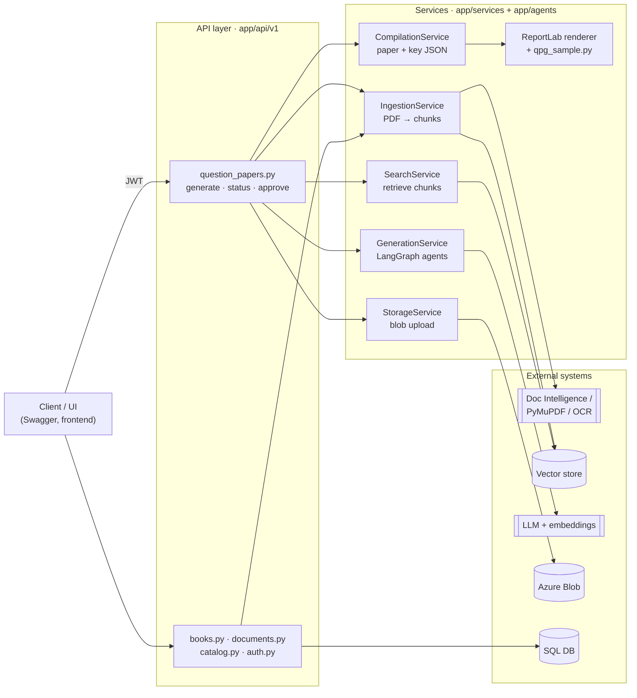
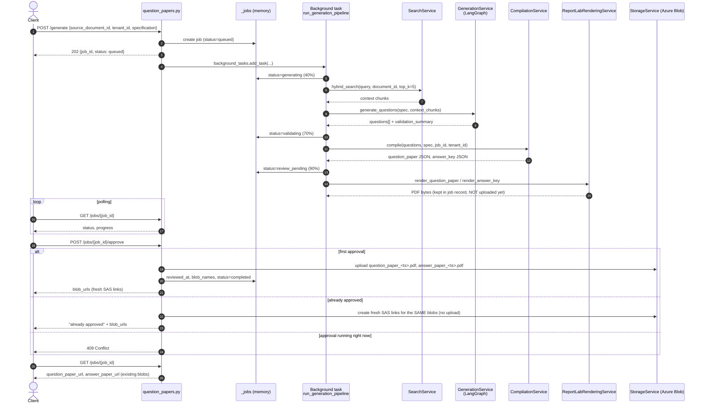
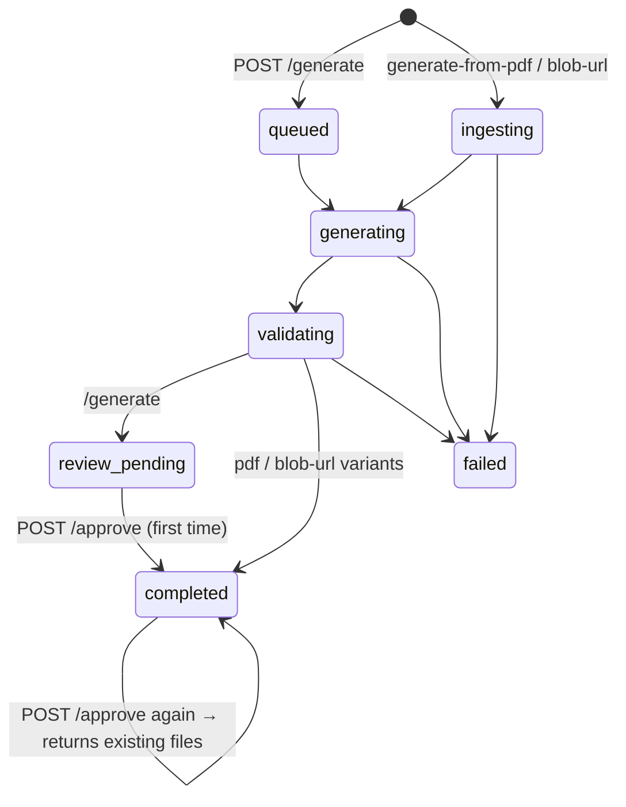
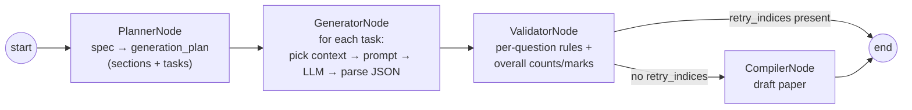
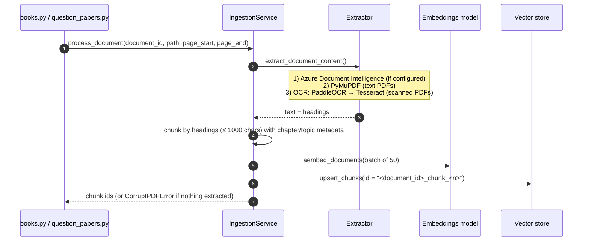
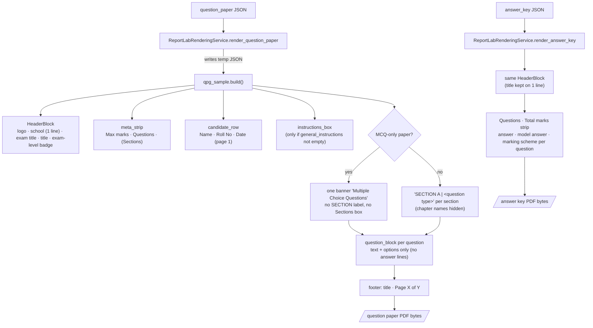

# Question Paper Generator: Low-Level Design (LLD)

This document explains how the code works end to end, so that someone who has never seen the codebase can find their way around, follow a request through the system and make changes safely.

> **Diagrams** are written in [Mermaid](https://mermaid.js.org/). They render automatically on GitHub/Azure DevOps and in VS Code (with the *Markdown Preview Mermaid Support* extension).

---

## 1. What the service does

1. **Ingests** a textbook PDF: extracts text, splits it into chunks, creates embeddings and stores them in a vector store.
2. **Generates** a question paper from a JSON *specification* (sections, question types, marks, chapters) using an LLM, with the textbook chunks as context.
3. **Renders** two PDFs, the **question paper** and the **answer key**, and holds them for review.
4. On **approval**, uploads both PDFs to **Azure Blob Storage** (once per job) and returns download links.

**Tech stack:** Python 3.11 · FastAPI · LangGraph/LangChain (LLM orchestration) · ReportLab (PDF) · SQLAlchemy (async) · PostgreSQL + pgvector / Azure AI Search / Chroma / in-memory (vector store) · Azure Blob Storage · Azure Document Intelligence / PyMuPDF / OCR (PDF text extraction) · Docker.

---

## 2. Folder map

```
qpg-generator/
├── app/
│   ├── main.py                       # Entry point: creates the FastAPI app
│   ├── api/
│   │   ├── __init__.py               # create_app(): CORS, routers, /health, DB init on startup
│   │   └── v1/
│   │       ├── question_papers.py    # ★ generate / status / approve endpoints + background pipelines
│   │       ├── books.py              # book upload / ingest-from-URL / bulk ingest
│   │       ├── documents.py          # source-document upload & listing
│   │       ├── catalog.py            # grade → subject → book browsing
│   │       └── auth.py               # demo login → JWT
│   ├── core/
│   │   ├── config.py                 # All settings, read from .env (pydantic-settings)
│   │   ├── llm_client.py             # get_chat_model() / get_embeddings_model(): Ollama / OpenAI / Azure OpenAI
│   │   └── auth/jwt_handler.py       # validate_token dependency (Bearer JWT)
│   ├── agents/                       # ★ LLM generation pipeline (LangGraph)
│   │   ├── generation_graph.py       # Graph wiring: planner → generator → validator → compiler
│   │   ├── prompts.py                # Prompt templates, per-question-type instructions
│   │   └── nodes/
│   │       ├── planner_node.py       # Spec → list of question "tasks"
│   │       ├── generator_node.py     # Task + context → question JSON (LLM call per task)
│   │       ├── validator_node.py     # Rule checks on generated questions
│   │       └── compiler_node.py      # Builds draft paper (output not used by the API, see §11)
│   ├── services/
│   │   ├── ingestion_service.py      # PDF → text → chunks → embeddings → vector store
│   │   ├── ocr_service.py            # PaddleOCR / Tesseract for scanned PDFs
│   │   ├── search_service.py         # Query → embedding → vector store search
│   │   ├── vector_store/             # Pluggable stores: postgres | azure_ai_search | chroma | local
│   │   ├── generation_service.py     # Thin wrapper that runs the LangGraph pipeline
│   │   ├── compilation_service.py    # ★ Builds final question_paper JSON + answer_key JSON
│   │   ├── reportlab_rendering_service.py  # ★ JSON → PDF bytes (paper + answer key)
│   │   ├── markdown_rendering_service.py   # JSON → Markdown (kept in memory)
│   │   ├── storage_service.py        # Azure Blob upload / SAS URL
│   │   ├── book_service.py, document_service.py  # DB CRUD for books/documents
│   │   └── pdf_rendering_service.py  # Old HTML→PDF renderer (no longer used by the API)
│   ├── schemas/                      # Pydantic request/response models (JobCreate, Specification …)
│   ├── models/                       # SQLAlchemy tables (books, documents, chunks …)
│   ├── db/__init__.py                # Async engine, session factory, init_db()
│   ├── templates/                    # Old Jinja HTML templates (used only by pdf_rendering_service)
│   └── static/images/edusol_logo.jpeg  # Default logo
├── qpg_sample.py                     # ★ PDF layout engine for the question paper (ReportLab): header, banners, questions
├── tests/ (unit, integration)        scripts/ (demo / helper scripts)
├── Dockerfile, docker-compose.yml, requirements.txt, .env
└── LLD.md                            # this document
```

★ = files you will touch most often.

---

## 3. Component diagram



Read it left to right: the **API layer** receives requests and calls **services** in order (ingest → search → generate → compile → render → store), and the services talk to **external systems**. Job state is kept in the in-memory `_jobs` dict inside `question_papers.py`. `IngestionService` and `SearchService` also call the embeddings model, which is left out of the diagram to keep it readable.

---

## 4. API endpoints

All routes are prefixed with `/api/v1`. Question-paper routes require `Authorization: Bearer <JWT>` (get one from `/api/v1/auth/login`). Interactive docs are at `/docs`.

| Method & path | Purpose | Handler |
|---|---|---|
| `POST /auth/login` | Demo login, returns a JWT | `auth.login` |
| `POST /question-papers/generate` | Start generation for an **already-ingested** document | `generate_question_paper` → `run_generation_pipeline` |
| `POST /question-papers/generate-from-pdf` | Upload a PDF + spec, ingest and generate | `generate_question_paper_from_pdf` → `run_generation_pipeline_from_pdf` |
| `POST /question-papers/generate-from-blob-url` | Download a PDF from a blob URL, ingest and generate | `generate_question_paper_from_blob_url` → `run_generation_pipeline_from_blob` |
| `GET /question-papers/jobs/{job_id}` | Job status; after approval also returns the PDF links | `get_job_status` |
| `POST /question-papers/jobs/{job_id}/approve` | Approve **once**, upload PDFs to blob, return links | `approve_question_paper` |
| `POST /books/upload`, `/books/ingest-from-url`, `/books/bulk-ingest` | Add books to the catalog and ingest them | `books.py` |
| `GET /catalog/...` | Browse grades → subjects → books | `catalog.py` |
| `POST/GET /documents/...` | Source document upload and listing | `documents.py` |
| `GET /health` | Liveness check | `api/__init__.py` |

---

## 5. Main flow: generate → poll → approve



The `/generate-from-pdf` and `/generate-from-blob-url` variants are the same flow with an **ingestion step first** (see §7). Those two set `status=completed` when generation finishes instead of `review_pending`; approval works the same way for both.

### Job lifecycle



"Approved" is indicated by `job["reviewed_at"]` being set, not by `status` alone.

---

## 6. Generation pipeline (LangGraph)

Wired in `app/agents/generation_graph.py`. All nodes share one `GenerationState` dict.



| Node | Input → Output | Notes |
|---|---|---|
| **PlannerNode** (`planner_node.py`) | `specification` → `generation_plan` | Converts every section into tasks (one per question). Maps spec types to internal ones (`fill_in_the_blanks`→`fill_in_the_blank`, `picture_based`→`picture_based_mcq`, `very_short_answer`→`one_word_answer`, `case_based`→`case_study`). Rebalances question counts if the section marks don't add up to `total_marks`. |
| **GeneratorNode** (`generator_node.py`) | tasks + `context_chunks` → `questions[]` | One LLM call per task. Chooses context by chapter (strict when `constraints.strict_chapter_mapping`). Prompts come from `prompts.py`. Each question keeps its `section_title`, which is used later for grouping. |
| **ValidatorNode** (`validator_node.py`) | `questions[]` → `validation_flags`, `retry_indices` | Checks options for MCQ, pairs for match-the-following, counts and marks per section. |
| **CompilerNode** (`compiler_node.py`) | → draft `question_paper` | The API ignores this output and uses `CompilationService` instead (§8). |

The LLM is chosen by `LLM_PROVIDER` in `.env` (`ollama` | `openai` | `azure_openai`) inside `core/llm_client.py`.

---

## 7. Ingestion flow (books and PDFs)



- The backend is chosen by `VECTOR_STORE_PROVIDER` (`postgres` | `azure_ai_search` | `chroma` | `local`) in `services/vector_store/factory.py`. Every backend implements the same `VectorStoreClient` interface (`upsert_chunks`, `search`, `count_chunks`, `close`), so switching is a config change only.
- Books (`books.py`) are tracked in the SQL DB; status goes to READY or FAILED after background ingestion.

---

## 8. Compilation and PDF rendering

### 8.1 CompilationService (`services/compilation_service.py`)
Takes the generated `questions[]` and the request `specification`, and produces two JSON objects that are stored on the job:

- **question_paper**: header fields, totals, `general_instructions`, `sections` (questions grouped by the spec's `section_title`, in spec order), `specification_hash`, `generated_at`, `metadata`.
- **answer_key**: header fields, totals, negative-marking info (from `specification.mark_distribution`), `answers[]` (answer outline, sample answer, marking scheme, sub-answers for case studies).

**Header fields** are read from `paper_metadata` first, then from the top level of `specification`:

| Field | Default |
|---|---|
| `school_name` | empty (line not shown) |
| `exam_title` | empty (line not shown) |
| `title` | "Generated Question Paper" |
| `exam_level` | `grade_level` |
| `logo_url` | `edusol_logo.jpeg` (resolved against `app/static/images`) |

**General instructions:** printed **only** when `show_general_instructions` is `true` (default `false`). When it is true, the request's `general_instructions` are used, or the default three if none were sent.

### 8.2 Rendering



Rendering rules (all in `qpg_sample.py` unless noted):

- **MCQ-only paper**: every question is `multiple_choice` or `picture_based_mcq`. All sections are merged into one "Multiple Choice Questions" banner and the Sections box is hidden (`merge_if_mcq_only`). Question order does not change, so numbering still matches the answer key.
- **Mixed paper**: one banner per spec section showing only the question type, e.g. `SECTION B | Short Answer` (`type_titled`, `TYPE_LABELS`).
- **No answer space**: questions show text plus options only (`answer_area`).
- These rules only change the PDF. The JSON keeps the chapter-wise section titles for retrieval.
- `markdown_rendering_service.py` also produces Markdown versions, which are kept in the job record only.

---

## 9. Storage layout and approval rules

Container: `tenant-<tenant_id>-outputs`

```
<job_id>/question_paper_<YYYYMMDDTHHMMSSZ>.pdf
<job_id>/answer_paper_<YYYYMMDDTHHMMSSZ>.pdf
```

- Both files from one approval share one UTC timestamp (`job["version_ts"]`).
- **Approve runs once per job.** Later calls, and `GET /jobs/{id}`, return links to the **same** blobs. Nothing is rendered or uploaded again.
- Links are **SAS URLs valid for 1 hour**, so a new link is created on every request from the stored `job["blob_names"]`.
- If an upload fails, the job is **not** marked approved and the endpoint returns `502`. A retry uploads only the missing file and reuses the same timestamp.
- Two approvals at the same time: the second one gets `409` (`job["approval_in_progress"]`).

---

## 10. Key data shapes

### 10.1 `POST /generate` request
```json
{
  "source_document_id": "doc-12345",
  "tenant_id": "school-001",
  "additional_material_ids": [],
  "page_start": 1, "page_end": 50, "ocr_dpi": 200,
  "specification": {
    "paper_metadata": {
      "title": "Geometry Practice Test",
      "subject": "Mathematics",
      "grade_level": "Grade 10",
      "paper_difficulty_level": "easy",
      "total_marks": 33,
      "school_name": "Delhi Public School, Bengaluru East",
      "exam_title": "Half-Yearly Examination 2026",
      "exam_level": "Grade 10",
      "logo_url": "https://.../logo.png",
      "show_general_instructions": false,
      "general_instructions": ["..."]
    },
    "constraints": { "strict_chapter_mapping": true },
    "mark_distribution": { "negative_marking_enabled": false, "negative_mark_weight": 0.25 },
    "sections": [
      {
        "section_id": "Section_A",
        "section_title": "Algebra - Multiple Choice",
        "question_type": "multiple_choice",
        "total_questions_to_generate": 3,
        "marks_per_question": 5,
        "instructions": "Choose the correct answer from the given options.",
        "topic_distribution": [
          { "chapter_id": "Algebra-1", "chapter_name": "Algebra", "question_count": 3 }
        ]
      }
    ]
  }
}
```
Schemas: `JobCreate` in `app/schemas/job.py`, `Specification` in `app/schemas/specification.py`. `specification` is accepted as a plain dict, so the Pydantic `Specification` model documents the fields but is not enforced.

**Supported `question_type` values:** `multiple_choice`, `true_false`, `fill_in_the_blank(s)`, `match_the_following`, `picture_based(_mcq)`, `one_word_answer` / `very_short_answer`, `short_answer`, `long_answer`, `problem_solving`, `case_study` / `case_based`.

### 10.2 Job record (`_jobs[job_id]`, in memory)
| Key | Set by | Meaning |
|---|---|---|
| `status`, `current_step`, `progress_percentage` | pipeline | progress |
| `specification`, `tenant_id`, `source_document_id` | create | request data |
| `question_paper`, `answer_key` | compile | final JSON |
| `question_paper_pdf_bytes`, `answer_paper_pdf_bytes` | render | PDFs waiting for approval |
| `question_paper_md_content`, `answer_paper_md_content` | render | Markdown copies |
| `validation_summary` | pipeline | JSON string |
| `reviewed_at`, `reviewed_by`, `review_comments` | approve | **approval marker** |
| `blob_names`, `version_ts`, `approval_in_progress` | approve | storage bookkeeping |
| `error_message`, `completed_at` | pipeline | outcome |

### 10.3 Generated question (inside `question_paper.sections[].questions[]`)
```json
{ "id": "q_1", "question_type": "multiple_choice", "question_text": "...",
  "options": ["...", "...", "...", "..."], "marks": 5, "topic": "...", "chapter_id": "Algebra-1",
  "case_passage": "... (case_study only)", "sub_questions": [ {"question_text": "...", "question_type": "...", "options": [], "marks": 1} ] }
```

---

## 11. Known gaps and things to watch

1. **Jobs live only in memory (`_jobs`).** A restart loses all jobs, and the "approve once" rule doesn't work across multiple server instances. Fix: store jobs in the SQL DB (`app/models/job.py` already has a model).
2. **Retrieval query is often empty.** `run_generation_pipeline` builds the search query from `spec['subject']` and `spec['title']`, but these live inside `paper_metadata`, so the query is usually blank. Read them from `paper_metadata` instead.
3. **Two compilers.** `CompilerNode` (in the graph) and `CompilationService` (in the API) both build a paper; only `CompilationService` output is used.
4. **Validator retry path ends the graph.** If the validator flags retries, the graph ends without compiling. The API still compiles whatever questions were returned.
5. **Negative marking on the answer key** reads `specification.mark_distribution`, not `constraints`.
6. **`qpg_sample.py` sits at the repo root** and is imported via `sys.path` from `reportlab_rendering_service.py`. Keep it there, or move it into `app/` and update the import.
7. **Demo login** (`admin` / `admin@123`) is hard-coded in `auth.py`. Replace it before production.

---

## 12. Configuration (`.env`)

| Variable | Values / purpose |
|---|---|
| `LLM_PROVIDER` | `ollama` · `openai` · `azure_openai` |
| `EMBEDDING_PROVIDER` | `ollama` · `openai` |
| `OPENAI_API_KEY`, `OPENAI_MODEL`, `OPENAI_BASE_URL`, `OPENAI_EMBEDDING_MODEL` | OpenAI settings |
| `AZURE_OPENAI_*` | Azure OpenAI endpoint, key, deployment names |
| `OLLAMA_BASE_URL`, `OLLAMA_MODEL` | Local Ollama |
| `VECTOR_STORE_PROVIDER` | `postgres` · `azure_ai_search` · `chroma` · `local` |
| `POSTGRES_HOST/PORT/DB/USER/PASSWORD/SSL_MODE` or `DATABASE_URL` | SQL DB + pgvector |
| `AZURE_SEARCH_ENDPOINT/KEY/INDEX` | Azure AI Search |
| `AZURE_DOC_INTEL_ENDPOINT/KEY` | Optional: better PDF extraction |
| `AZURE_STORAGE_CONNECTION_STRING`, `BLOB_CONNECTION_STRING`, `AZURE_BLOB_CONTAINER` | Blob storage |
| `SECRET_KEY` | **Required.** JWT signing key |
| `ENVIRONMENT`, `LOG_LEVEL` | App settings |

---

## 13. Running locally

```bash
pip install -r requirements.txt
# create .env (see §12); SECRET_KEY is mandatory
uvicorn app.main:app --reload          # http://localhost:8000/docs
# or
docker compose up --build
pytest tests/unit -v                    # unit tests
```

Quick manual test:
1. `POST /api/v1/auth/login` with `{"username":"admin","password":"admin@123"}` and copy the token.
2. In Swagger, click **Authorize** and paste the token.
3. Call `POST /api/v1/question-papers/generate-from-pdf` with a PDF and the specification JSON.
4. Poll `GET /jobs/{job_id}` until the status is `completed` or `review_pending`.
5. Call `POST /jobs/{job_id}/approve` to get the blob links.

To try a PDF layout change without the LLM, render directly from a saved JSON:
```bash
python qpg_sample.py output/question_paper.json -o test.pdf --assets app/static/images
```

---

## 14. Where to change common things

| I want to… | Change this |
|---|---|
| Change the question paper look (header, banners, fonts, colours, footer) | `qpg_sample.py`: `HeaderBlock`, `section_banner`, `question_block`, `make_canvas`, colour constants at the top |
| Change the answer key look | `services/reportlab_rendering_service.py` → `render_answer_key` |
| Add a field to the PDF header | Read it in `compilation_service.py` (`header` dict), show it in `qpg_sample.header_fields` + `HeaderBlock` |
| Add a new question type | `planner_node.py` (`type_mapping`), `prompts.py` (type instruction), `validator_node.py` (rules), `qpg_sample.py` (`answer_area`, `DEFAULT_INSTR`, `TYPE_LABELS`) |
| Change LLM prompts | `app/agents/prompts.py`, `generator_node.py` |
| Switch LLM or vector store | `.env` only (`LLM_PROVIDER`, `VECTOR_STORE_PROVIDER`) |
| Add a vector store backend | New class implementing `VectorStoreClient` in `services/vector_store/`, register it in `factory.py` |
| Change blob naming or approval behaviour | `api/v1/question_papers.py` → `approve_question_paper`, `_existing_blob_urls`, `_OUTPUT_FILES` |
| Add an endpoint | New router in `app/api/v1/`, include it in `app/api/v1/__init__.py` |
| Change PDF text extraction / chunking | `services/ingestion_service.py` (`extract_document_content`, `_chunk_document`) |
